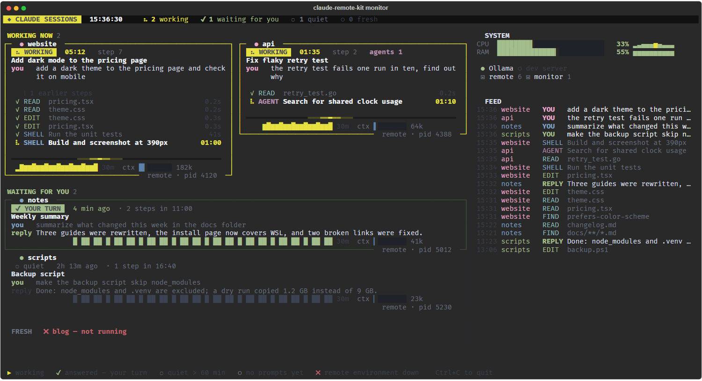

# claude-remote-kit

Keep [Claude Code](https://code.claude.com/docs) sessions on your Windows PC reachable from your phone,
and see at a glance what every session is doing — in a terminal, in a browser, and as a push notification
when one of them is waiting for you.

[Русская версия](README.ru.md)



*(screenshot made with made-up sessions)*

## What is inside

| part | what it does |
|---|---|
| **Remote environments** (`scripts/start-remote.ps1`) | Opens one WezTerm window with a tab per project folder. Each tab runs `claude remote-control` and restarts it if it exits or the network drops. Every folder shows up as an environment in the Claude app and on claude.ai/code, so you can start sessions in it from your phone. |
| **New session on demand** (`scripts/new-session.ps1`) | Opens a Claude session with Remote Control in any folder, as a new tab. `-Persistent` adds the folder to your project list. |
| **Launcher** (`scripts/start-launcher.ps1`, `launcher/CLAUDE.md`) | An optional Claude session whose only job is to open other sessions when you ask it from the phone: "open a session in C:\code\site". |
| **Monitor** (`monitor/monitor.py`) | A live terminal dashboard of every Claude Code session on the machine: who is working and for how long, the current tool call, the last prompt and answer, a 30-minute activity chart, context size, CPU/RAM/GPU, optional local services and a feed of events. Read-only. |
| **Web monitor** (`monitor/web.py`) | The same screen in a browser, streamed from the PC. Installable as an app on iPhone/Android/Mac. Meant to be exposed with Tailscale Serve and open only to you. |
| **"Your turn" notifications** (`monitor/push.py`) | Web Push to your devices when a session finishes and waits for you, asks a question, or needs attention. End-to-end encrypted; keys are generated on first run. |

The monitor works with any Claude Code session (terminal, IDE, the desktop app), not only the ones the kit
starts. It reads `~/.claude/sessions/*.json` and the session transcripts in `~/.claude/projects/`.

## Requirements

- Windows 10/11 with Windows PowerShell 5.1 (built in).
- [Claude Code](https://code.claude.com/docs) on `PATH`, signed in. Remote environments need Remote Control
  to be available for your account; the monitor works without it.
- [WezTerm](https://wezterm.org/) — the scripts open windows and tabs through `wezterm cli`.
- Python 3.11+ for the monitor (`pip install -r monitor/requirements.txt`: rich, psutil, cryptography).
- Optional: [Tailscale](https://tailscale.com/) to open the web monitor from your phone or laptop.
- Optional: `nvidia-smi` for the GPU line.

## Install

```powershell
git clone https://github.com/<you>/claude-remote-kit.git
cd claude-remote-kit
python -m pip install -r monitor\requirements.txt
copy projects.example.txt projects.txt
notepad projects.txt
```

In `projects.txt`, list the folders you want to reach from your phone, one per line:

```
website | C:\code\website
notes   | %USERPROFILE%\Documents\notes
```

Then start everything:

```powershell
powershell -ExecutionPolicy Bypass -File scripts\start-remote.ps1     # remote environments
powershell -ExecutionPolicy Bypass -File scripts\start-monitor.ps1    # monitor (+ web monitor)
```

Open the Claude app on your phone: each folder from `projects.txt` is listed as an environment. The monitor
opens as a tab in the same window. The web monitor is at http://127.0.0.1:8790.

To bring it all up at every login:

```powershell
powershell -ExecutionPolicy Bypass -File scripts\install-autostart.ps1            # add -Launcher for the launcher
powershell -ExecutionPolicy Bypass -File scripts\install-autostart.ps1 -Remove    # undo
```

## Configure

Everything works without a config file if `claude`, `wezterm` and `python` are on `PATH`. To change
anything, copy `config.example.json` to `config.json` and edit it:

| key | default | meaning |
|---|---|---|
| `claude`, `wezterm`, `python` | command names | command on `PATH` or a full path to the executable |
| `wezterm_config` | empty | a WezTerm config file for the kit's windows (sets `WEZTERM_CONFIG_FILE`) |
| `state_dir` | `state` | runtime files: window sockets, push keys and subscriptions, logs |
| `projects_file` | `projects.txt` | the list of remote environments |
| `monitor.web_port` | `8790` | port of the web monitor (listens on 127.0.0.1 only) |
| `monitor.allowed_users` | `[]` | Tailscale logins allowed to open the web monitor through Tailscale Serve |
| `monitor.push_contact` | empty | `mailto:` or `https:` contact sent to push services; by default the monitor's own address |
| `monitor.services` | `[]` | local services to show as up/down, e.g. `[{"name": "Ollama", "port": 11434}]` |
| `monitor.your_turn_minutes` | `60` | how long an answered session counts as "your turn" before it becomes "quiet" |
| `monitor.context_tokens` | `1000000` | the size of the context bar |

Relative paths are relative to the kit folder. Environment variables override the file: `CRK_CONFIG`
(path to another config file), `CRK_WEB_PORT`, `CRK_ALLOWED_USERS` (comma-separated), `CRK_STATE_DIR`.

## Open the web monitor from your phone (Tailscale)

1. Install Tailscale on the PC and on the phone, signed in to the same tailnet.
2. Put your Tailscale login (usually your email) into `config.json`:
   ```json
   { "monitor": { "allowed_users": ["you@example.com"] } }
   ```
   and restart the web monitor — stop its Python process, the keeper script starts it again in 5 s:
   ```powershell
   Get-CimInstance Win32_Process -Filter "Name='python.exe'" |
     Where-Object CommandLine -like '*monitor\web.py*' | ForEach-Object { Stop-Process -Id $_.ProcessId }
   ```
3. Publish the local port inside your tailnet only:
   ```powershell
   tailscale serve --bg --https=8444 http://127.0.0.1:8790
   ```
4. Open `https://<your-pc>.<your-tailnet>.ts.net:8444` on the phone. On iPhone, use Share → **Add to Home
   Screen**, open the app from there and tap 🔔 to get notifications (iOS allows Web Push only for installed
   web apps).

## Security

- **The web server listens on 127.0.0.1 only.** Nothing is reachable from your LAN or the internet unless
  you publish it yourself.
- **Owner-only access.** Tailscale Serve adds the caller's login to each request (`Tailscale-User-Login`).
  A request that came through the proxy is served only if that login is in `monitor.allowed_users`; with the
  list empty, every proxied request gets 403. Requests without proxy headers come from the PC itself and are
  allowed. Being in the tailnet is not enough: shared devices and other users of the tailnet are refused.
- **Do not use Tailscale Funnel** (public internet) for the monitor: it shows your prompts and Claude's
  answers.
- **Push payloads are encrypted** for each device (RFC 8291), so Apple/Google/Mozilla push servers cannot
  read them. The VAPID key and subscriptions live in `state/push/`, are created on first run and are ignored
  by git. Never commit `state/`.
- **POST requests** (subscribe, unsubscribe, test) accept JSON only and reject foreign `Origin` headers.
- **The monitor is read-only.** It never writes to `~/.claude`. The browser page cannot send anything to your
  sessions.
- **Remote Control** itself is a Claude Code feature: whoever is signed in to your Claude account can drive
  sessions in the folders you list. List only folders you are comfortable working on from your phone.

## How it works

```
 phone / laptop                         your Windows PC
 ───────────────                        ──────────────────────────────────────────────────────
 Claude app,  ◄──── Anthropic ────►  WezTerm window "remote"
 claude.ai/code      (Remote Control)    ├─ tab: claude remote-control  (C:\code\website)
                                         ├─ tab: claude remote-control  (C:\code\notes)
                                         ├─ tab: launcher (optional)
                                         └─ tab: monitor.py ─── reads ~/.claude/sessions, transcripts
 browser / PWA  ◄── Tailscale Serve ──►  web.py (127.0.0.1:8790) ── same screen as ANSI over SSE
 notifications  ◄── Web Push ─────────   push.py: state change → encrypted push
```

The start scripts record each window's WezTerm socket in `state/wezterm-<label>.txt`, so later scripts can
add tabs to the right window and the monitor can count its tabs.

## Notes

- The Russian Claude Code skills (`implement`, `investigate`, `diff-review`, `explore-area`,
  `prompt-writing`) that the original setup used are **not included**: they were adapted from another
  person's configuration that has no license, so they cannot be redistributed under MIT.
- Only Windows is supported. The monitor itself is plain Python and mostly portable; the PowerShell
  scripts and the process-tree heuristics are Windows-specific. Contributions welcome.

## License

[MIT](LICENSE). The bundled xterm.js files are MIT-licensed by their authors, see
[monitor/web/THIRD_PARTY_NOTICES.md](monitor/web/THIRD_PARTY_NOTICES.md).

This is an independent project, not affiliated with or endorsed by Anthropic.
