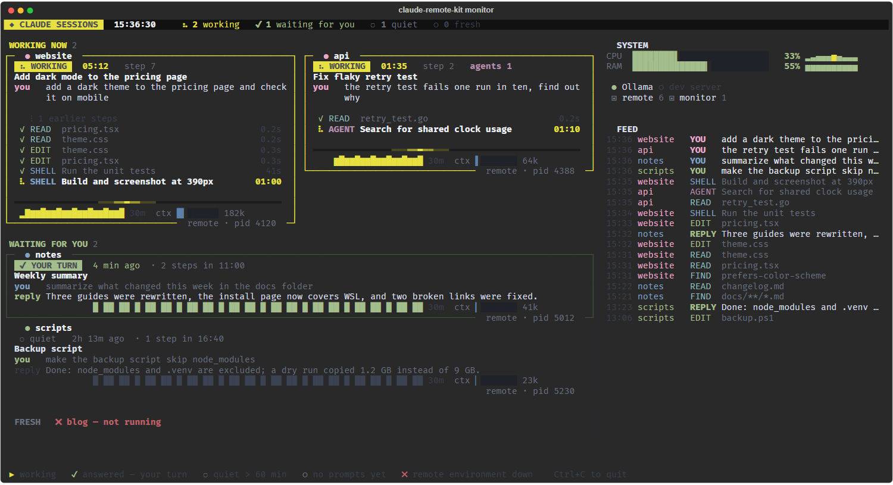

# claude-remote-kit

Сессии [Claude Code](https://code.claude.com/docs) на вашем компьютере с Windows остаются доступны с
телефона, а что делает каждая из них — видно сразу: в терминале, в браузере и push-уведомлением, когда
сессия ждёт вас.

[English version](README.md)



*(скриншот сделан на выдуманных сессиях)*

## Что внутри

| часть | что делает |
|---|---|
| **Удалённые окружения** (`scripts/start-remote.ps1`) | Открывает одно окно WezTerm, по вкладке на папку проекта. В каждой вкладке `claude remote-control`, с перезапуском, если процесс упал или пропала сеть. Каждая папка видна как окружение в приложении Claude и на claude.ai/code — в ней можно начинать сессии с телефона. |
| **Новая сессия по запросу** (`scripts/new-session.ps1`) | Открывает сессию Claude с удалённым доступом в любой папке новой вкладкой. С `-Persistent` папка добавляется в список проектов. |
| **Пульт** (`scripts/start-launcher.ps1`, `launcher/CLAUDE.md`) | Необязательная сессия Claude, которая по просьбе с телефона открывает другие сессии: «открой сессию в C:\code\site». |
| **Мониторинг** (`monitor/monitor.py`) | Живая сводка в терминале по всем сессиям Claude Code на компьютере: кто работает и сколько, текущий инструмент, последний запрос и ответ, график активности за 30 минут, размер контекста, CPU/RAM/GPU, ваши локальные службы и лента событий. Только читает. |
| **Веб-мониторинг** (`monitor/web.py`) | Тот же экран в браузере, потоком с компьютера. Ставится как приложение на iPhone, Android, Mac. Рассчитан на Tailscale Serve с доступом только для вас. |
| **Уведомления «твой ход»** (`monitor/push.py`) | Web Push на ваши устройства, когда сессия закончила и ждёт ответа, задала вопрос или требует внимания. Содержимое зашифровано для устройства; ключи создаются при первом запуске. |

Мониторинг видит любые сессии Claude Code (терминал, IDE, приложение), а не только запущенные этим
набором. Он читает `~/.claude/sessions/*.json` и журналы сессий в `~/.claude/projects/`.

## Что нужно

- Windows 10/11 с Windows PowerShell 5.1 (встроен).
- [Claude Code](https://code.claude.com/docs) в `PATH`, с выполненным входом. Для удалённых окружений нужен
  доступный вашему аккаунту Remote Control; мониторинг работает и без него.
- [WezTerm](https://wezterm.org/) — окна и вкладки открываются через `wezterm cli`.
- Python 3.11+ для мониторинга (`pip install -r monitor/requirements.txt`: rich, psutil, cryptography).
- По желанию: [Tailscale](https://tailscale.com/), чтобы открывать веб-мониторинг с телефона или ноутбука.
- По желанию: `nvidia-smi` для строки GPU.

## Установка

```powershell
git clone https://github.com/<you>/claude-remote-kit.git
cd claude-remote-kit
python -m pip install -r monitor\requirements.txt
copy projects.example.txt projects.txt
notepad projects.txt
```

В `projects.txt` перечислите папки, которые должны быть доступны с телефона, по одной на строку:

```
website | C:\code\website
notes   | %USERPROFILE%\Documents\notes
```

Запуск:

```powershell
powershell -ExecutionPolicy Bypass -File scripts\start-remote.ps1     # удалённые окружения
powershell -ExecutionPolicy Bypass -File scripts\start-monitor.ps1    # мониторинг (+ веб-мониторинг)
```

Откройте приложение Claude на телефоне: каждая папка из `projects.txt` видна как окружение. Мониторинг
открывается вкладкой в том же окне, веб-мониторинг — http://127.0.0.1:8790.

Чтобы всё поднималось при каждом входе в Windows:

```powershell
powershell -ExecutionPolicy Bypass -File scripts\install-autostart.ps1            # -Launcher — ещё и пульт
powershell -ExecutionPolicy Bypass -File scripts\install-autostart.ps1 -Remove    # убрать
```

## Настройка

Без файла настроек всё работает, если `claude`, `wezterm` и `python` есть в `PATH`. Чтобы что-то
поменять, скопируйте `config.example.json` в `config.json`:

| ключ | по умолчанию | что значит |
|---|---|---|
| `claude`, `wezterm`, `python` | имена команд | команда из `PATH` или полный путь к программе |
| `wezterm_config` | пусто | свой конфиг WezTerm для окон набора (ставит `WEZTERM_CONFIG_FILE`) |
| `state_dir` | `state` | рабочие файлы: сокеты окон, ключи и подписки push, журналы |
| `projects_file` | `projects.txt` | список удалённых окружений |
| `monitor.web_port` | `8790` | порт веб-мониторинга (слушает только 127.0.0.1) |
| `monitor.allowed_users` | `[]` | логины Tailscale, которым можно открывать веб-мониторинг через Tailscale Serve |
| `monitor.push_contact` | пусто | контакт `mailto:` или `https:` для служб push; по умолчанию адрес самого мониторинга |
| `monitor.services` | `[]` | локальные службы, которые показывать живыми или нет, например `[{"name": "Ollama", "port": 11434}]` |
| `monitor.your_turn_minutes` | `60` | сколько минут после ответа сессия считается «твой ход», потом — «тихо» |
| `monitor.context_tokens` | `1000000` | размер шкалы контекста |

Относительные пути считаются от папки набора. Переменные окружения важнее файла: `CRK_CONFIG` (путь к
другому файлу настроек), `CRK_WEB_PORT`, `CRK_ALLOWED_USERS` (через запятую), `CRK_STATE_DIR`.

## Веб-мониторинг с телефона (Tailscale)

1. Поставьте Tailscale на компьютер и телефон, вход в одну сеть (tailnet).
2. Впишите свой логин Tailscale (обычно почта) в `config.json`:
   ```json
   { "monitor": { "allowed_users": ["you@example.com"] } }
   ```
   и перезапустите веб-мониторинг — остановите его процесс Python, сторож поднимет его через 5 с:
   ```powershell
   Get-CimInstance Win32_Process -Filter "Name='python.exe'" |
     Where-Object CommandLine -like '*monitor\web.py*' | ForEach-Object { Stop-Process -Id $_.ProcessId }
   ```
3. Опубликуйте локальный порт только внутри своей сети Tailscale:
   ```powershell
   tailscale serve --bg --https=8444 http://127.0.0.1:8790
   ```
4. Откройте на телефоне `https://<ваш-компьютер>.<ваша-сеть>.ts.net:8444`. На iPhone: «Поделиться» →
   **«На экран „Домой“»**, откройте значок оттуда и нажмите 🔔 (iOS разрешает Web Push только установленным
   веб-приложениям).

## Безопасность

- **Веб-сервер слушает только 127.0.0.1.** Ни из локальной сети, ни из интернета он не виден, пока вы сами
  его не опубликуете.
- **Доступ только владельцу.** Tailscale Serve добавляет к каждому запросу логин (`Tailscale-User-Login`).
  Запрос через прокси обслуживается, только если этот логин есть в `monitor.allowed_users`; при пустом
  списке любой запрос через прокси получает 403. Запросы без заголовков прокси идут с самого компьютера и
  пропускаются. Просто быть в tailnet недостаточно: чужие устройства и другие пользователи сети получат отказ.
- **Не публикуйте мониторинг через Tailscale Funnel** (в открытый интернет): на нём видны ваши запросы и
  ответы Claude.
- **Содержимое push зашифровано** для каждого устройства (RFC 8291): серверы Apple, Google, Mozilla его не
  читают. Ключ VAPID и подписки лежат в `state/push/`, создаются при первом запуске и не попадают в git.
  Никогда не коммитьте `state/`.
- **POST-запросы** (подписка, отписка, проверка) принимают только JSON и отклоняют чужой `Origin`.
- **Мониторинг только читает.** В `~/.claude` он ничего не пишет; со страницы нельзя ничего отправить в сессии.
- **Remote Control** — функция Claude Code: кто вошёл в ваш аккаунт Claude, тот может управлять сессиями в
  перечисленных папках. Добавляйте только те папки, с которыми готовы работать с телефона.

## Как это устроено

```
 телефон / ноутбук                      компьютер с Windows
 ─────────────────                      ──────────────────────────────────────────────────────
 приложение Claude, ◄── Anthropic ──►  окно WezTerm «remote»
 claude.ai/code       (Remote Control)   ├─ вкладка: claude remote-control  (C:\code\website)
                                         ├─ вкладка: claude remote-control  (C:\code\notes)
                                         ├─ вкладка: пульт (по желанию)
                                         └─ вкладка: monitor.py ── читает ~/.claude/sessions и журналы
 браузер / PWA  ◄── Tailscale Serve ──►  web.py (127.0.0.1:8790) ── тот же экран, ANSI через SSE
 уведомления    ◄── Web Push ─────────   push.py: смена состояния → зашифрованный push
```

Скрипты запуска записывают сокет каждого окна WezTerm в `state/wezterm-<метка>.txt`: так следующие
скрипты добавляют вкладки в нужное окно, а мониторинг считает его вкладки.

## Заметки

- Навыки Claude Code на русском (`implement`, `investigate`, `diff-review`, `explore-area`,
  `prompt-writing`), с которыми работала исходная связка, **в набор не входят**: они переделаны из чужой
  конфигурации без лицензии, поэтому распространять их под MIT нельзя.
- Поддерживается только Windows. Сам мониторинг — обычный Python и в основном переносим; скрипты PowerShell
  и разбор дерева процессов — под Windows. Доработки приветствуются.

## Лицензия

[MIT](LICENSE). Файлы xterm.js распространяются их авторами под MIT, см.
[monitor/web/THIRD_PARTY_NOTICES.md](monitor/web/THIRD_PARTY_NOTICES.md).

Независимый проект, не связан с Anthropic и не одобрен ею.
